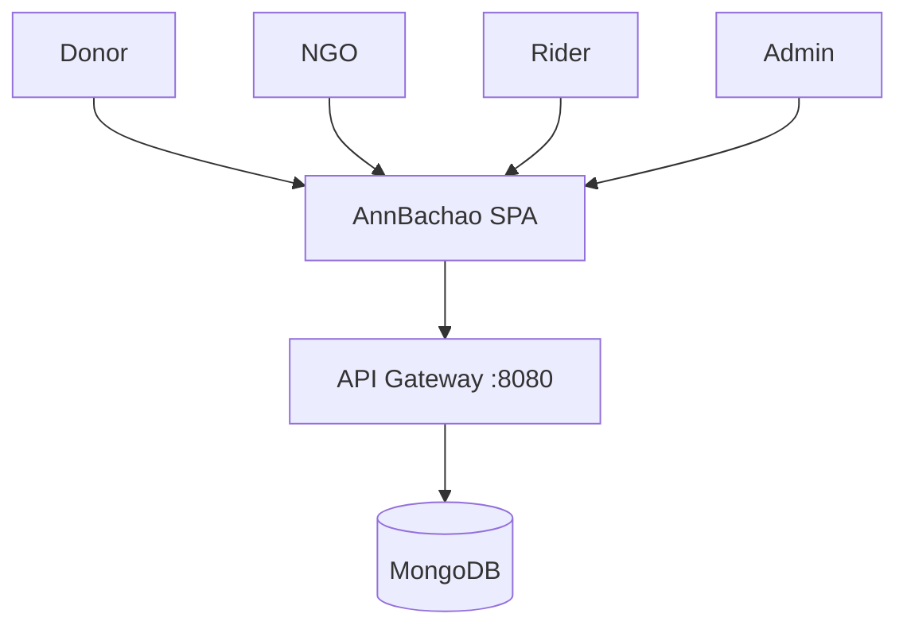
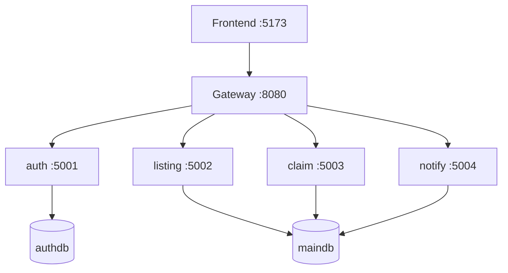
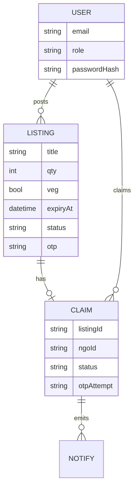
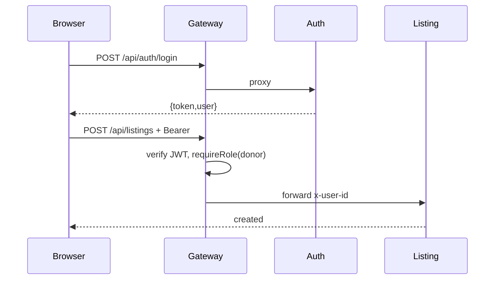
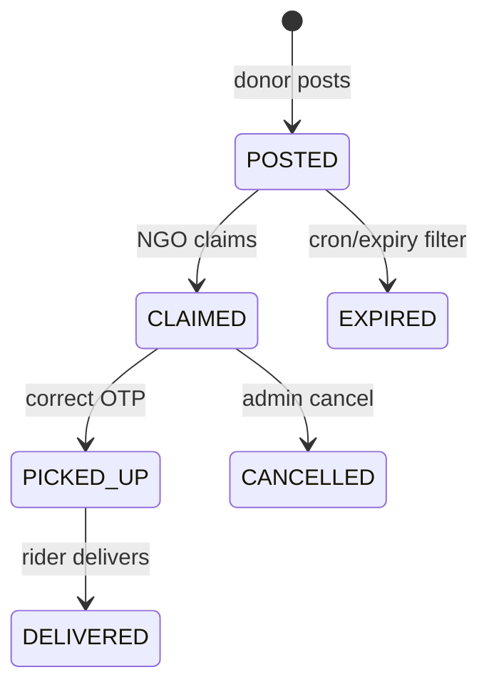
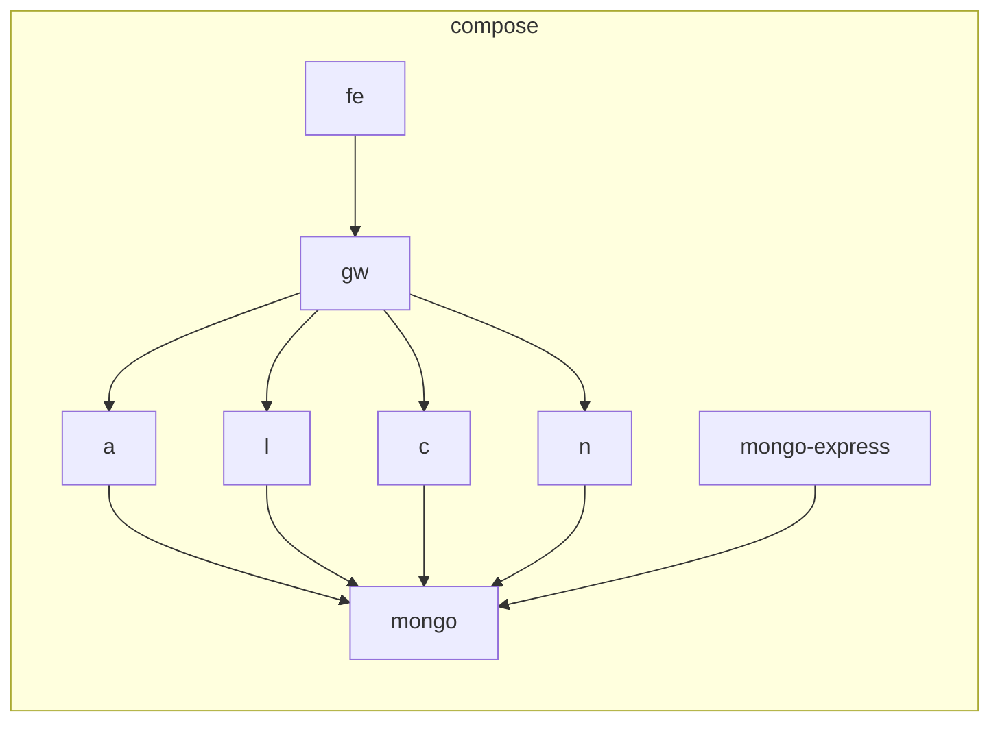

# All Diagrams — AnnBachao

## 1. C4 Level 1 (Context)

## 2. C4 Level 2 (Containers)

## 3. ER

## 4. JWT Sequence

## 5. Claim State Machine

## 6. Docker Topology

## 7. User Flows
- Donor: login → Post → MyListings sees OTP → Rider picks → Leaderboard up
- NGO: login → Browse filter city/veg → Claim → MyClaims OTP → share OTP offline to rider
- Rider: login → Pickups → enter OTP → Deliver
